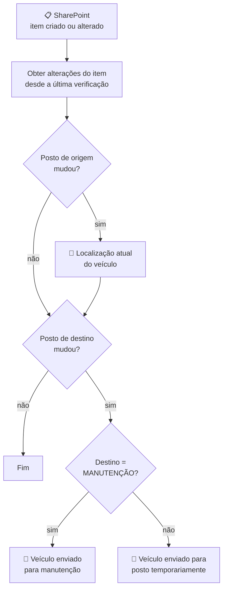

# Fleet Status Automation — Avisos de movimentação de veículos da frota

Automação em **Power Automate** em cima da lista de **Frotas** do **SharePoint (Microsoft Lists)**, onde Suprimentos registra cada veículo da empresa: placa, modelo, posto de origem e posto de destino. Sempre que um veículo muda de lugar, o fluxo avisa os gestores por **e-mail (Outlook)**: nova localização, envio para manutenção ou envio temporário para outro posto.

## Fluxo

| Fluxo | Gatilho | O que faz |
|-------|---------|-----------|
| [Mudar Status — Frotas](fluxos/Mudar-Status-Frotas) | Item criado ou alterado na lista (verificação a cada 1 min) | Detecta qual coluna mudou e envia o aviso correspondente: localização atual, manutenção ou posto temporário |


## O problema

Os veículos da frota circulam entre os postos de atendimento: mudam de base, vão para a oficina ou são emprestados por alguns dias a outro posto. A lista de Frotas era atualizada, mas ninguém era avisado. Os gestores só descobriam que um carro tinha saído da base quando precisavam dele, e não havia registro de quando cada mudança aconteceu.

## Como funciona



1. **Gatilho:** "Quando um item é criado ou modificado" na lista de Frotas. Cada item alterado gera uma execução separada (`splitOn`).
2. **O que mudou:** a ação **Obter alterações de um item** compara o item com a versão do início da janela do gatilho e informa, coluna a coluna, o que foi alterado (`ColumnHasChanged`).
3. **Posto de origem alterado:** o veículo tem uma nova base fixa. O fluxo envia o aviso **"Localização atual do veículo"** com placa, posto e modelo.
4. **Posto de destino alterado:**
   - destino **MANUTENÇÃO** → aviso **"Veículo enviado para manutenção"**;
   - qualquer outro posto → aviso **"Veículo enviado para posto temporariamente"**.
5. **Base acompanhada de perto:** quando a movimentação envolve uma base específica (no fluxo original, a base de Vila Nova Conceição), o assunto do e-mail ganha o nome dela como sufixo.

## Decisões de projeto

- **Aviso só quando o posto muda:** sem a checagem de `ColumnHasChanged`, qualquer edição na lista (corrigir o modelo, preencher uma observação) dispararia e-mail. Com ela, só a mudança de posto gera aviso.
- **Origem e destino avaliados em sequência, não em "senão":** se alguém altera as duas colunas na mesma edição, saem os dois avisos.
- **Origem = base fixa, destino = deslocamento:** a lista separa onde o carro "mora" de para onde ele foi. Assim dá para saber que um veículo está na oficina ou emprestado sem perder a referência de qual posto ele pertence.
- **Assunto com o nome da base:** o sufixo no assunto permite criar regras no Outlook e filtrar a caixa de entrada pelos veículos da base que mais exige acompanhamento, sem um fluxo separado.
- **E-mail em cartão HTML:** placa, posto de origem, posto de destino e modelo aparecem numa tabela simples, legível no celular.

## Estrutura do repositório

```
pacotes/
└── Mudar-Status-Frotas.zip       ← pacote pronto para importar no Power Automate
fluxos/
└── Mudar-Status-Frotas/          ← o mesmo pacote descompactado, para leitura
    ├── manifest.json             ← recursos e conexões do pacote
    └── Microsoft.Flow/flows/<id>/
        └── definition.json       ← definição do fluxo (gatilho, condições e e-mails)
```

## Como usar

1. No Power Automate: **Meus fluxos → Importar → Importar pacote (herdado)** e selecione `pacotes/Mudar-Status-Frotas.zip`.
2. Na importação, escolha **Criar como novo** e selecione (ou crie) as conexões de **SharePoint** e **Office 365 Outlook**.
3. Depois de importar, abra o fluxo e, no gatilho e na ação **Obter alterações de um item**, selecione o seu site e a sua lista (os valores originais foram trocados por `SEU-TENANT`/`SEU-SITE` e `<<PREENCHER>>`).
4. Nas ações **Enviar um email (V2)**, coloque os destinatários.
5. A lista precisa ter as colunas `Title` (placa), `PostoOrigem` e `PostoDestino` (escolha, com a opção `MANUTENÇÃO` entre os destinos) e `Modelo` (escolha). Para usar o sufixo no assunto, troque `VILA NOVA CONCEICAO` nas condições pelo nome da sua base.
6. **Habilite o controle de versão da lista** (padrão no Microsoft Lists): a ação "Obter alterações" depende dele para comparar as colunas.
7. Ative o fluxo.

## Segurança

O pacote publicado aqui não tem placas reais, nomes de responsáveis, endereços do SharePoint, IDs de listas, do tenant ou de usuários, nem e-mails ou contas de conexão. Todos os valores sensíveis foram substituídos por marcadores.
